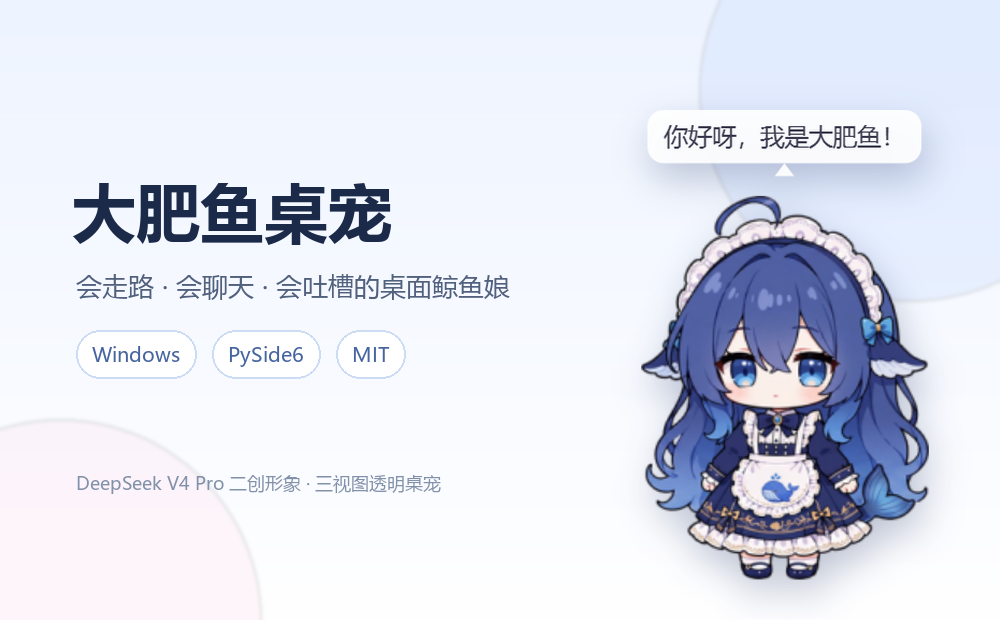

# 大肥鱼桌宠 🐋

[](https://github.com/1190fasheqi/dafeiyu-pet/actions/workflows/test.yml)



DeepSeek V4 Pro 二创形象「鲸鱼娘·大肥鱼」的透明桌面宠物。

基于三视图素材（正面 / 侧面 / 背面），用 Python + PySide6 实现，无边框透明置顶窗口。

## 下载 / 快速开始

### 方式一：免安装 exe（推荐）

到 [Releases](https://github.com/1190fasheqi/dafeiyu-pet/releases) 下载 `大肥鱼桌宠.exe`，双击即用，不需要安装 Python。

> 杀毒软件可能对 PyInstaller 产物误报，加信任即可。

### 方式二：从源码运行

需要 **Python 3.11+**：

```bash
pip install -r requirements.txt
python 桌宠.py
```

Windows 用户也可以直接双击 `启动桌宠.bat`（自动选择 `.venv` 或系统 Python；缺依赖时会在窗口里提示）。

## 功能

- **三视图行走**：左右走用侧面（自动镜像）、向上走用背面、向下走用正面
- **三种模式**：自由散步 / 跟随鼠标 / 原地待着（右键菜单切换）
- **互动**：
  - 左键按住：拖拽（会侧身朝向拖动方向，松手会说话）
  - 单击：蹦跳 + 回嘴（互动台词）+ 弹出 🗨️ 聊天面板（5 秒无操作自动收起）
  - 双击：喂食面板（小鱼干 / 蛋糕 / 棒棒糖 / 团子 / 钻石）
  - 右键：完整菜单（模式 / 大小 / 喂食 / 说句话 / 设置 Key / 查看天气 / 设置城市 / 显示隐藏 / 回到屏幕内 / 鼠标穿透 / 置顶 / 开机自启 / 退出；托盘右键是同款菜单，穿透后可从托盘解除）
- **台词系统**：日常随机台词 + 互动回嘴 + 思维链心声（灰色斜体括号气泡，小概率冒出），全部取材自社区 DS 梗
- **细节**：呼吸 / 摇摆 / 蹦跳 / 进食动画、转向交叉淡化、加减速惯性、散步自动休息、说话冷却
- 托盘图标、窗口置顶、鼠标穿透、开机自启、配置记忆（`config.json`）；设置改动立即保存，穿透 / 置顶状态重启后自动恢复

### AI 对话

- 左键单击 → 点击 🗨️ → 弹出聊天输入框
- 调用 DeepSeek API（默认 `deepseek-chat` 模型），每句话不超过 25 字，风格贱兮兮但可爱
- 对话历史保留最近 40 条（自动记忆上下文）
- API Key 通过右键菜单「设置 Key」输入（密码框），保存到 `config.json`
- 也兼容其他 OpenAI 协议接口：修改 `config.json` 里的 `api_base` / `api_model` 即可
  （例如 `"api_base": "https://api.deepseek.com/v1"`、`"api_model": "deepseek-chat"`）
- 聊天期间鱼会暂停移动，但呼吸 / 摇摆 / 小动作照常

### 天气查询

- 右键菜单「查看天气」→ 后台线程调用 `wttr.in`，不会卡住桌宠
- 城市可在右键菜单「设置城市」里修改，也保存在 `config.json` 的 `"city"` 字段
- 鱼会气泡播报：「汕头今天 26°，天气多云」

### 系统状态监控

- **CPU**：超过 90% 时冒泡提醒
- **内存**：超过 95% 时冒泡提醒
- **显卡（NVIDIA）**：温度超过 80°C 时冒泡提醒（`pynvml` 读取）
- 检测间隔 10 秒，不频繁打扰

## 配置

首次运行会在程序目录生成 `config.json`。可参考 [`config.example.json`](config.example.json)：

| 字段 | 说明 |
|------|------|
| `mode` | `wander` 自由散步 / `follow` 跟随鼠标 / `still` 原地待着 |
| `size` | 大小倍率：`0.55` / `0.7` / `0.9` |
| `topmost` | 是否窗口置顶 |
| `passthrough` | 是否鼠标穿透 |
| `autostart` | 是否开机自启 |
| `x` / `y` | 上次位置 |
| `ds_api_key` | DeepSeek / OpenAI 协议 API Key |
| `api_base` | 接口地址，默认 `https://api.deepseek.com/v1` |
| `api_model` | 模型名，默认 `deepseek-chat` |
| `city` | 天气城市，默认 `汕头` |

运行日志写在程序目录的 `pet.log`，启动失败或异常时可先看这里。

## 打包成独立 exe

```bash
pip install pyinstaller
pyinstaller --noconfirm --onefile --windowed --name 大肥鱼桌宠 --add-data "sprites;sprites" --icon icon.ico 桌宠.py
```

产物在 `dist/大肥鱼桌宠.exe`。推送 `v*` 标签时，GitHub Actions 也会自动构建并发布 Release（见 `.github/workflows/build-release.yml`）。

## 更换形象

把新的三视图（白底）放到程序目录，然后：

```bash
python preprocess.py    # 白底抠图 + 统一高度
python preprocess2.py   # 边缘去污 + 预乘 alpha 缩放出各尺寸精灵
```

素材不在程序目录时，也可以传入路径：

```bash
python preprocess.py <素材目录> [输出目录]
```

## 文件说明

| 文件 | 说明 |
|------|------|
| 桌宠.py | 主程序（全部逻辑） |
| preprocess.py | 白底三视图抠图脚本 |
| preprocess2.py | 精灵边缘去污 + 多尺寸生成脚本 |
| sprites/ | 精灵图（正面/侧面/背面 各尺寸 + 图标） |
| 启动桌宠.bat | 启动脚本（自动选择 venv 或系统 Python，缺环境会提示） |
| requirements.txt | 依赖 |
| config.example.json | 配置示例 |
| 桌宠.spec | PyInstaller 打包配置 |
| test_pet.py | 基础自动化测试（菜单 / 配置保存 / 喂食动画 / 天气异步） |
| .github/workflows/build-release.yml | 打 tag 自动构建 exe 并发布 Release |

## 测试

```bash
python test_pet.py
```

## 常见问题

**双击 `启动桌宠.bat` 没反应 / 一闪而过**
先确认装了 Python 3.11+，安装时勾选「Add Python to PATH」。临时排查可在 cmd 里运行：

```bash
python 桌宠.py
```

缺什么依赖会直接报出来。也可以直接下载 Releases 里的 exe。

**缺少 PySide6**
```bash
python -m pip install -r requirements.txt
```

**天气获取失败**
`wttr.in` 在国内网络下偶尔不稳定，稍后重试或换个网络即可；失败不会卡住桌宠。

**开机自启没有生效**
确认程序所在路径没有被移动 / 删除；重新勾选一次「开机自启」会重建启动快捷方式。

## 贡献与致谢

- **AI 对话 / 天气查询 / 系统监控 / PyInstaller 打包配置**：由 [Cpanoe](https://github.com/Cpanoe) 通过 [PR#3](https://github.com/1190fasheqi/dafeiyu-pet/pull/3) 贡献（DeepSeek API 聊天、wttr.in 天气、CPU/内存/GPU 监控、桌宠.spec）。
- 合并时维护方修复：
  - 线程安全：DeepSeek 回复由后台线程直接调用 Qt 界面改为经队列转发主线程（`_say_queue`）
  - 配置保护：`config.json` 保持不入仓库（本地配置含 API Key，防止泄露）
- 桌面宠物朝向修复由 [B-A-A-GE](https://github.com/B-A-A-GE) 通过 [PR#1](https://github.com/1190fasheqi/dafeiyu-pet/pull/1) 提交（未合并，当前为维护方修复版）。

## 台词梗来源

台词均取自 DeepSeek / 鲸鱼娘 / 大肥鱼社区梗（D指导去吃饭、吃白饭、梁文锋会议三连、"才不是大肥鱼"、思维链心声等），感谢社区整活。

## 协议与声明

代码使用 MIT 协议。

角色形象为 DeepSeek「鲸鱼娘·大肥鱼」二创，仅供学习交流，请勿用于商业用途；形象版权归原作者所有。
